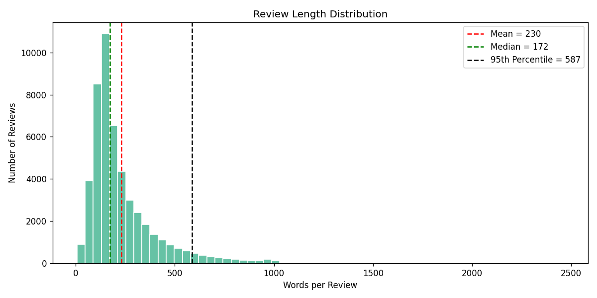
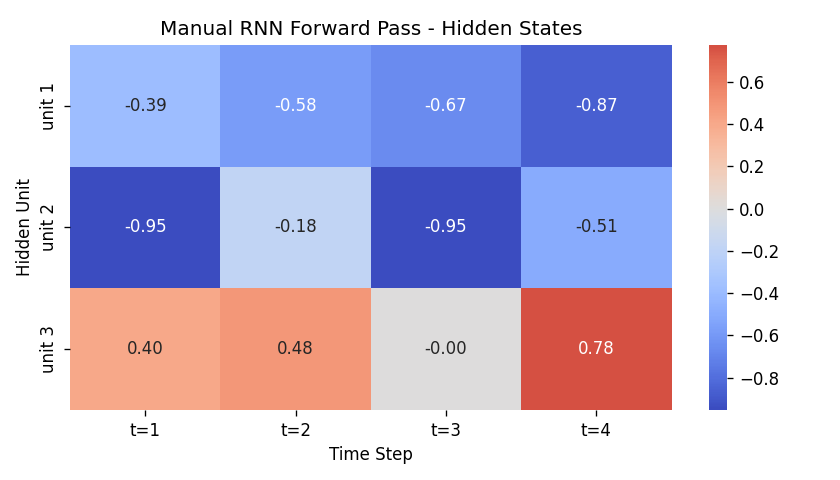
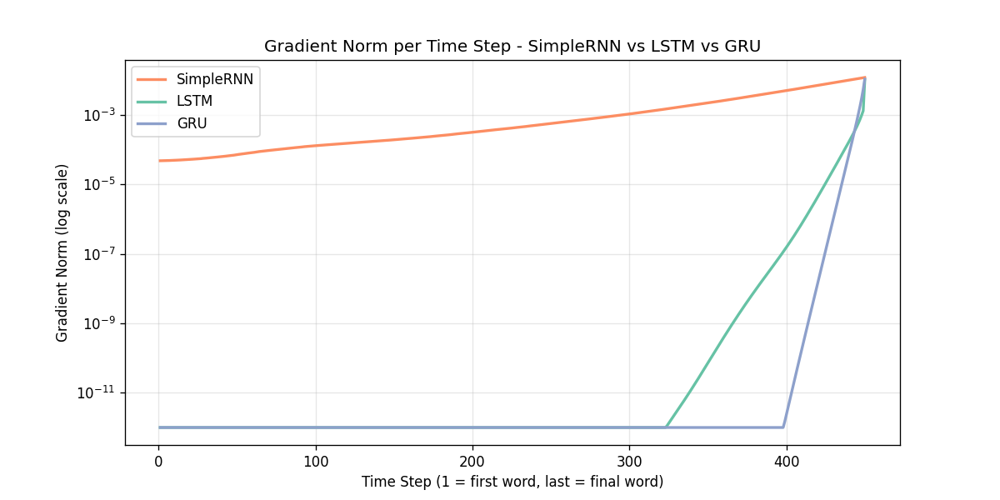
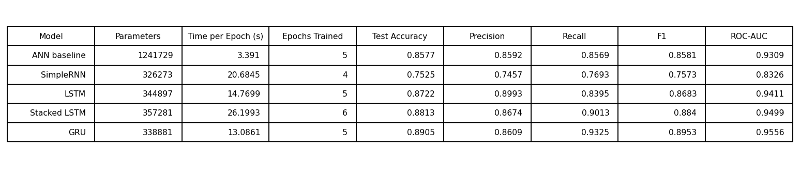
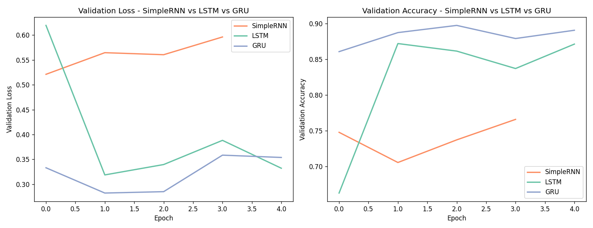
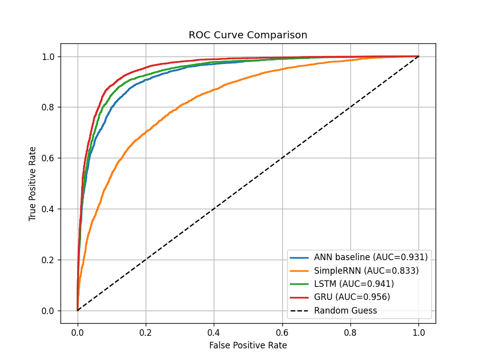
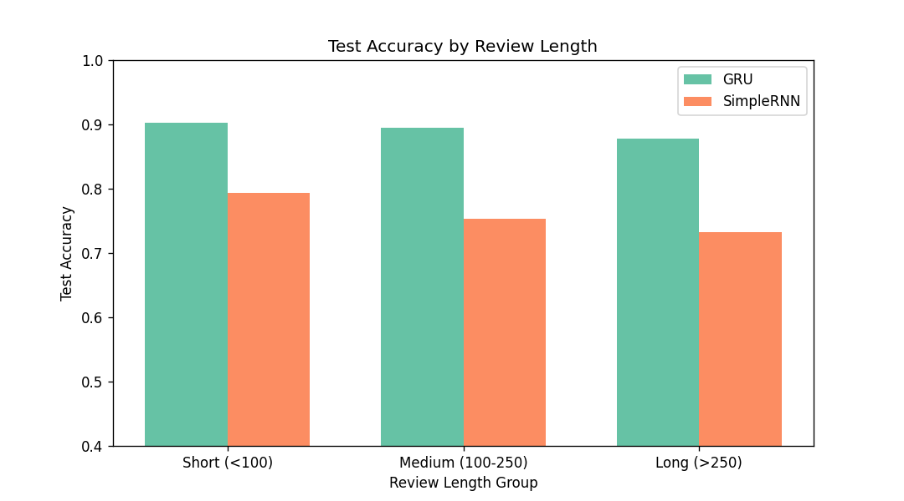

<div align="center">

# 🎬 IMDB Sentiment Analysis with RNN, LSTM & GRU

### *Why do gated networks beat a plain RNN on long movie reviews?* 


**Deep Learning · Practical 5 · Sequence Models for Text**

[📓 Notebook](./DL_PR5.ipynb) • [🌐 HTML Report](./DL_PR5.html) • [📊 Results](#-full-results-table) • [🎥 Video](#-video-walkthrough) • [💡 Recommendation](#-recommendation)

</div>

---

## 📑 Table of Contents

- [🎯 Project Overview](#-project-overview)
- [📦 Dataset & Citation](#-dataset--citation)
- [🧹 Preprocessing Summary](#-preprocessing-summary)
- [🏗️ Model Architectures](#️-model-architectures)
  - [🔁 SimpleRNN](#-simplernn)
  - [🧠 LSTM](#-lstm)
  - [⚡ GRU](#-gru)
- [📉 Gradient-Norm Analysis](#-gradient-norm-analysis)
- [📊 Full Results Table](#-full-results-table)
- [📈 More Plots](#-more-plots)
- [💡 Recommendation](#-recommendation)
- [🎥 Video Walkthrough](#-video-walkthrough)
- [🛠️ Tools Used](#️-tools-used)
- [📁 Repository Structure](#-repository-structure)
- [🚀 How to Run](#-how-to-run)
- [📚 References](#-references)

---

## 🎯 Project Overview

This project classifies **50,000 IMDB movie reviews** as 😊 **positive** or 😞 **negative** and compares five models:

| # | Model | Idea |
|---|-------|------|
| 1️⃣ | 🧱 **ANN baseline** | Order-blind `Embedding → Flatten → Dense` |
| 2️⃣ | 🔁 **SimpleRNN** | Reads words one by one with a tanh memory |
| 3️⃣ | 🧠 **LSTM** | Adds a cell state and three gates |
| 4️⃣ | 🥞 **Stacked LSTM** | Two LSTM layers on top of each other |
| 5️⃣ | ⚡ **GRU** | A lighter gated cell with two gates |

Along the way the notebook also:

- ✍️ builds a **manual RNN forward pass in NumPy** and verifies it against Keras,
- 🔬 measures **vanishing gradients** with `tf.GradientTape` (BPTT),
- 💥 demonstrates **exploding gradients and gradient clipping**,
- 📏 tests how **review length** affects accuracy.

---

## 📦 Dataset & Citation

- 🔗 **Kaggle dataset:** [IMDB Dataset of 50K Movie Reviews](https://www.kaggle.com/datasets/lakshmi25npathi/imdb-dataset-of-50k-movie-reviews)
- 📄 **Size:** 50,000 reviews · 2 columns (`review`, `sentiment`) · perfectly balanced (25,000 positive / 25,000 negative) · no missing values

> 📝 **Citation (Maas et al.)**
>
> Maas, A. L., Daly, R. E., Pham, P. T., Huang, D., Ng, A. Y., & Potts, C. (2011). *Learning Word Vectors for Sentiment Analysis.* In **Proceedings of the 49th Annual Meeting of the Association for Computational Linguistics: Human Language Technologies (ACL 2011)**, pp. 142–150. Portland, Oregon, USA.

<details>
<summary>📋 BibTeX</summary>

```bibtex
@inproceedings{maas-EtAl:2011:ACL-HLT2011,
  author    = {Maas, Andrew L. and Daly, Raymond E. and Pham, Peter T. and Huang, Dan and Ng, Andrew Y. and Potts, Christopher},
  title     = {Learning Word Vectors for Sentiment Analysis},
  booktitle = {Proceedings of the 49th Annual Meeting of the Association for Computational Linguistics: Human Language Technologies},
  month     = {June},
  year      = {2011},
  address   = {Portland, Oregon, USA},
  publisher = {Association for Computational Linguistics},
  pages     = {142--150},
  url       = {http://www.aclweb.org/anthology/P11-1015}
}
```

</details>

---

## 🧹 Preprocessing Summary

Raw reviews were converted into clean, equal-length integer sequences in six steps:

| Step | What was done | Why 🤔 |
|:----:|---------------|--------|
| 1️⃣ | **Removed exact duplicate reviews** *before* splitting | Prevents **data leakage** (same review in train and test) |
| 2️⃣ | **Cleaned text:** lowercase, strip HTML tags (`<br />`), keep only letters and apostrophes, collapse spaces | Removes noise but keeps words like `don't` whole |
| 3️⃣ | **Kept stop-words** (e.g. *not*, *no*) | Negations flip sentiment: "not good" ≠ "good" |
| 4️⃣ | **Stratified 80 / 20 train–test split** (`random_state=42`) | Keeps the class balance equal in both sets |
| 5️⃣ | **Tokenised** with Keras `Tokenizer(num_words=10000, oov_token="<OOV>")`, **fitted on training text only** | Top 10k words carry most of the meaning; no vocabulary leakage from test |
| 6️⃣ | **Padded / truncated to `MAXLEN = 450`** with `padding="pre"` (≈ 90th percentile of review length, rounded to nearest 50) | Pre-padding puts the real words **last**, so the final hidden state is built from real words, not zeros |

<div align="center">



*📏 Review lengths are right-skewed: mean = 230 words, median = 172, 95th percentile = 587.*

</div>

**Training setup (identical for every recurrent model, so the comparison is fair):** embedding size `32` · hidden units `64` · optimizer `Adam (lr = 0.001)` · batch size `64` · `10%` validation split · `EarlyStopping` on validation loss · seed `42`.

---

## 🏗️ Model Architectures

### 🔁 SimpleRNN

A **SimpleRNN** reads a review one word at a time and keeps a hidden state
$h_t = \tanh(W_{xh}x_t + W_{hh}h_{t-1} + b)$ that acts as its memory. The same weights are reused at every time step, so the parameter count (**326,273** in total) does not depend on review length. We first re-implemented this equation by hand in NumPy and confirmed it matches Keras `SimpleRNN` exactly (`np.allclose → True`). The weakness shows up during **backpropagation through time**: the gradient is multiplied by $W_{hh}$ and a tanh derivative (≤ 1) at every step, so it shrinks quickly and early words receive almost no learning signal. In our experiments it was the **weakest and slowest-to-converge** model (75.25% accuracy, ROC-AUC 0.833) and its accuracy dropped further on longer reviews.

<div align="center">



*🔥 Manual NumPy RNN forward pass: hidden states over 4 time steps (all values stay within −1…+1 because of tanh).*

</div>

### 🧠 LSTM

The **LSTM** fixes the memory problem by adding a separate **cell state** $C_t$ protected by three gates: the **forget gate** (what to erase), the **input gate** (what to write) and the **output gate** (what to expose). Because the cell state is updated by *element-wise multiplication and addition* instead of repeated matrix multiplication, information and gradients can travel across many time steps with far less decay. With **344,897** parameters it reached **87.22% accuracy and ROC-AUC 0.941**, a big jump over SimpleRNN, and a **Stacked LSTM** (two layers, 357,281 parameters) improved this to **88.13% accuracy / 0.950 AUC**, at nearly double the training time per epoch (26.2 s).

### ⚡ GRU

The **GRU** is a streamlined gated cell: it merges the cell state and hidden state into one and uses only **two gates** (the **update gate** and the **reset gate**). Fewer gates mean fewer parameters (**338,881**) and faster training (**13.1 s/epoch**, the quickest recurrent model), while still letting the network keep or overwrite information as needed. On this dataset the GRU was the **best model overall** with **89.05% accuracy, 0.8953 F1 and 0.9556 ROC-AUC**, and it stayed the most accurate across short, medium and long reviews.

---

## 📉 Gradient-Norm Analysis

We unrolled each untrained cell step by step and used `tf.GradientTape` to measure the gradient norm of the loss with respect to the hidden state at **every** time step (log scale).

<div align="center">



</div>

> 🖼️ **Caption:** *Gradient norm per time step (log scale) for SimpleRNN, LSTM and GRU on a 450-word padded input; step 1 is the first word, step 450 the final word. All three cells receive their largest gradient at the last step (closest to the loss) and the gradient falls toward earlier words. SimpleRNN decays slowly and smoothly across the sequence (about 10⁻² at the end to ~10⁻⁵ at the start), while the LSTM and GRU gradients are concentrated in the final ~100 time steps and fall to the plot's 10⁻¹² numerical floor earlier in the sequence. These are freshly initialised, untrained cells, so the plot shows how gradient flow depends on the architecture's initial behaviour rather than on learned gate values.*

🔑 **Takeaway:** gradient flow depends on how information is routed through each cell, and in training the gated models learn to use their gates to keep useful information, which is why they win on accuracy (next section). Gradient clipping (`clipnorm=1.0`) was also shown to fix **exploding** gradients, but it cannot repair **vanishing** gradients, which is why gated architectures were invented.

---

## 📊 Full Results Table

<div align="center">



</div>

| 🏷️ Model | ⚙️ Parameters | ⏱️ Time / Epoch (s) | 🔄 Epochs | 🎯 Test Accuracy | 🔍 Precision | 📡 Recall | ⚖️ F1 | 📈 ROC-AUC |
|:--|--:|--:|--:|--:|--:|--:|--:|--:|
| ANN baseline | 1,241,729 | 3.39 | 5 | 0.8577 | 0.8592 | 0.8569 | 0.8581 | 0.9309 |
| SimpleRNN | 326,273 | 20.68 | 4 | 0.7525 | 0.7457 | 0.7693 | 0.7573 | 0.8326 |
| LSTM | 344,897 | 14.77 | 5 | 0.8722 | 0.8993 | 0.8395 | 0.8683 | 0.9411 |
| Stacked LSTM | 357,281 | 26.20 | 6 | 0.8813 | 0.8674 | 0.9013 | 0.8840 | 0.9499 |
| **🏆 GRU** | **338,881** | **13.09** | **5** | **0.8905** | 0.8609 | **0.9325** | **0.8953** | **0.9556** |

---

## 📈 More Plots

<table>
<tr>
<td align="center" width="50%">



**📉 Validation loss & accuracy:** GRU learns fastest and most stably; SimpleRNN's validation loss rises while LSTM/GRU's stays low.

</td>
<td align="center" width="50%">



**🎢 ROC curves:** GRU (AUC 0.956) sits closest to the top-left corner; SimpleRNN (0.833) is clearly the weakest.

</td>
</tr>
<tr>
<td align="center" colspan="2">



**📏 Accuracy by review length:** GRU stays above ~0.88 on short, medium **and** long reviews, while SimpleRNN falls from ~0.79 (short) to ~0.73 (long).

</td>
</tr>
</table>

---

## 💡 Recommendation

> ### 🏆 Use the **GRU** for this task.

| ✅ Reason | 📌 Evidence |
|-----------|------------|
| 🎯 **Highest quality** | Best accuracy (**0.8905**), F1 (**0.8953**) and ROC-AUC (**0.9556**) of all five models |
| ⚡ **Fast** | **13.1 s/epoch**, quicker than LSTM (14.8 s) and about half the time of Stacked LSTM (26.2 s) |
| 🪶 **Lightweight** | 338,881 parameters, fewer than LSTM and Stacked LSTM, and ~3.7× fewer than the ANN baseline |
| 📏 **Robust to length** | Stays accurate on long reviews where SimpleRNN degrades |

- 🥈 **Runner-up:** Stacked LSTM (0.8813 accuracy) if you want the extra depth and can afford the slower training.
- ❌ **Avoid SimpleRNN** for long text: it is slow, unstable and the least accurate.
- 🧱 The ANN baseline is a respectable and very fast keyword-style model, but it ignores word order and needs 1.2 M parameters.

---

## 🎥 Video Walkthrough

▶️ **Watch the project explanation here:** [🎬 Click to open the video](https://YOUR-VIDEO-LINK-HERE)

*(Replace the link above with your YouTube / Google Drive video URL.)*

---

## 🛠️ Tools Used

| Tool | Purpose |
|------|---------|
| 🐍 **Python 3.10+** | Programming language |
| 🧠 **TensorFlow / Keras** | Building and training RNN, LSTM, GRU; `GradientTape` for BPTT |
| 🔢 **NumPy** | Manual RNN forward pass and numerical work |
| 🐼 **Pandas** | Loading and cleaning the dataset |
| 🧪 **scikit-learn** | Train/test split, metrics (accuracy, precision, recall, F1, ROC-AUC) |
| 📊 **Matplotlib & Seaborn** | All plots and heatmaps |
| 📓 **Jupyter Notebook / Google Colab** | Development environment |
| 🐙 **Git & GitHub** | Version control and hosting |

---

## 📁 Repository Structure

```text
📦 imdb-sentiment-rnn-lstm-gru
├── 📓 DL_PR5.ipynb                  # Main notebook (all tasks)
├── 🌐 DL_PR5.html                   # HTML export of the notebook
├── 📄 README.md                     # You are here
├── 📋 requirements.txt              # Python dependencies
├── 🗃️ IMDB_Dataset.csv              # Kaggle dataset (50K reviews)
├── 📊 results_table.csv             # Final metrics table
└── 🖼️ plots/
    ├── length_distribution.png
    ├── rnn_forward_heatmap.png
    ├── gradient_norms_all_cells.png
    ├── training_curves_rnn_lstm_gru.png
    ├── roc_curves.png
    ├── results_table.png
    └── accuracy_by_length.png
```

---

## 🚀 How to Run

```bash
# 1️⃣ Clone the repository
git clone https://github.com/YOUR-USERNAME/imdb-sentiment-rnn-lstm-gru.git
cd imdb-sentiment-rnn-lstm-gru

# 2️⃣ (Optional) create a virtual environment
python -m venv venv
source venv/bin/activate        # Windows: venv\Scripts\activate

# 3️⃣ Install dependencies
pip install -r requirements.txt

# 4️⃣ Launch the notebook
jupyter notebook DL_PR5.ipynb
```

> 💻 **Tip:** training SimpleRNN/LSTM/GRU on 450-step sequences is slow on CPU. Use **Google Colab with a GPU**, or lower `MAXLEN` to `200` in the notebook for a faster run.

---

## 📚 References

1. Maas, A. L., et al. (2011). *Learning Word Vectors for Sentiment Analysis.* ACL 2011.
2. Hochreiter, S., & Schmidhuber, J. (1997). *Long Short-Term Memory.* Neural Computation, 9(8).
3. Cho, K., et al. (2014). *Learning Phrase Representations using RNN Encoder–Decoder for Statistical Machine Translation.* EMNLP 2014.
4. Pascanu, R., Mikolov, T., & Bengio, Y. (2013). *On the difficulty of training recurrent neural networks.* ICML 2013.

---

<div align="center">

### ⭐ If you found this project helpful, please give it a star! ⭐

Made with ❤️ and 🧠 using TensorFlow

</div>
